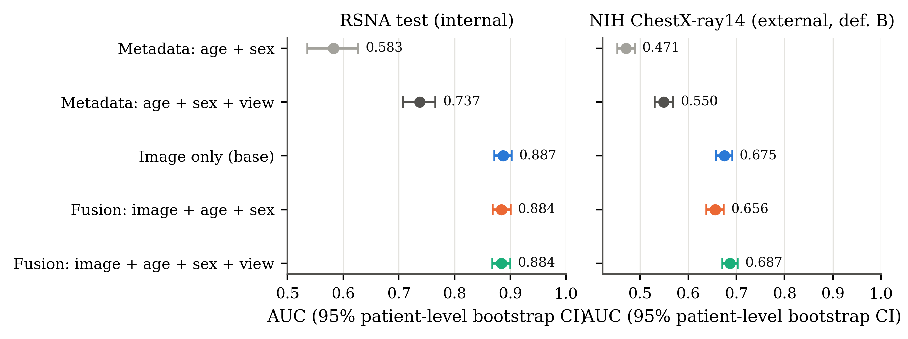

# Explainable Multimodal Pneumonia Detection

Does adding age, sex and view position help a chest X-ray pneumonia detector?
In our experiments, no, and view position turns out to be a dataset shortcut.

## Key results

| Model | Test AUC (RSNA) |
|---|---|
| Image only | 0.887 |
| Image + age/sex/view (fusion) | 0.884 |

A model using view position alone reaches AUC 0.737 internally but drops to
about 0.55 on the external NIH set, which is what a shortcut looks like.



## Data

Raw data is not included in this repository.

- RSNA Pneumonia Detection Challenge (Kaggle)
- NIH ChestX-ray14

See [`data/README.md`](data/README.md) for download and preparation steps.

## How to run

1. Open `notebooks/rsna-multimodal-pneumonia-xai-final.ipynb` on Kaggle.
2. Attach the RSNA and NIH datasets as inputs.
3. Settings: GPU T4, Internet on.
4. Run all cells (roughly 3 hours).

Local setup: `pip install -r requirements.txt`

## Repository layout

```
notebooks/   final notebook, with outputs
src/         standalone scripts (optional)
data/        data notes and codebook
results/     metrics CSVs and figures
paper/       LaTeX source, tables and figures
```

## Paper

Explainable Multimodal Pneumonia Detection on
Chest Radiographs: Does Patient Metadata Help?, Mariam Shaiq, Fatima Siddiqa. Source in [`paper/`](paper/).

## Authors

Mariam Shaiq
Fatima Siddiqa

## License

Code is released under the MIT License. RSNA and NIH data follow their own
licence terms.
